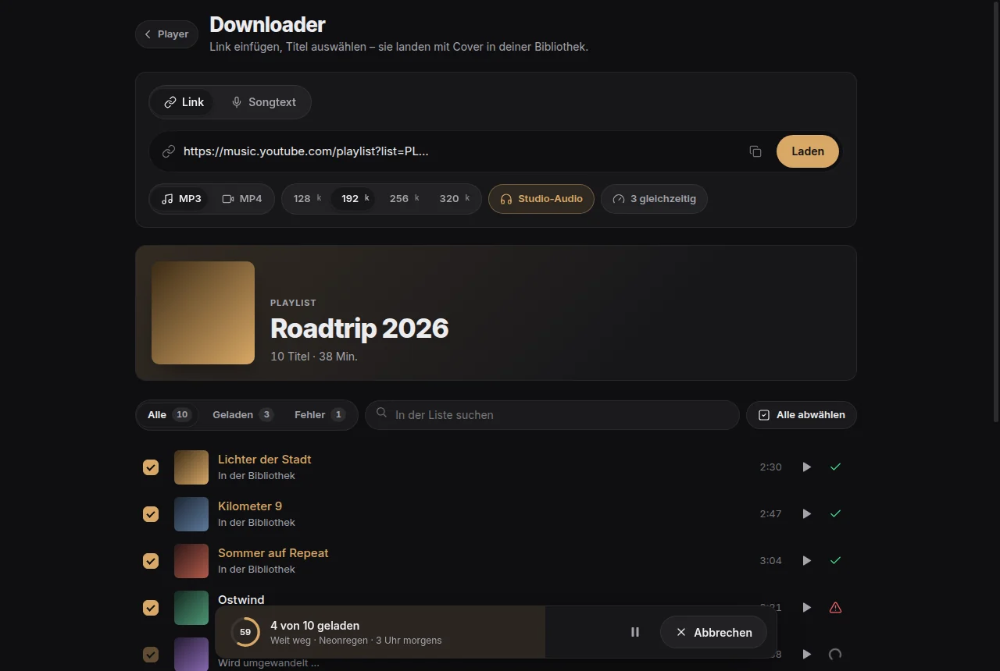
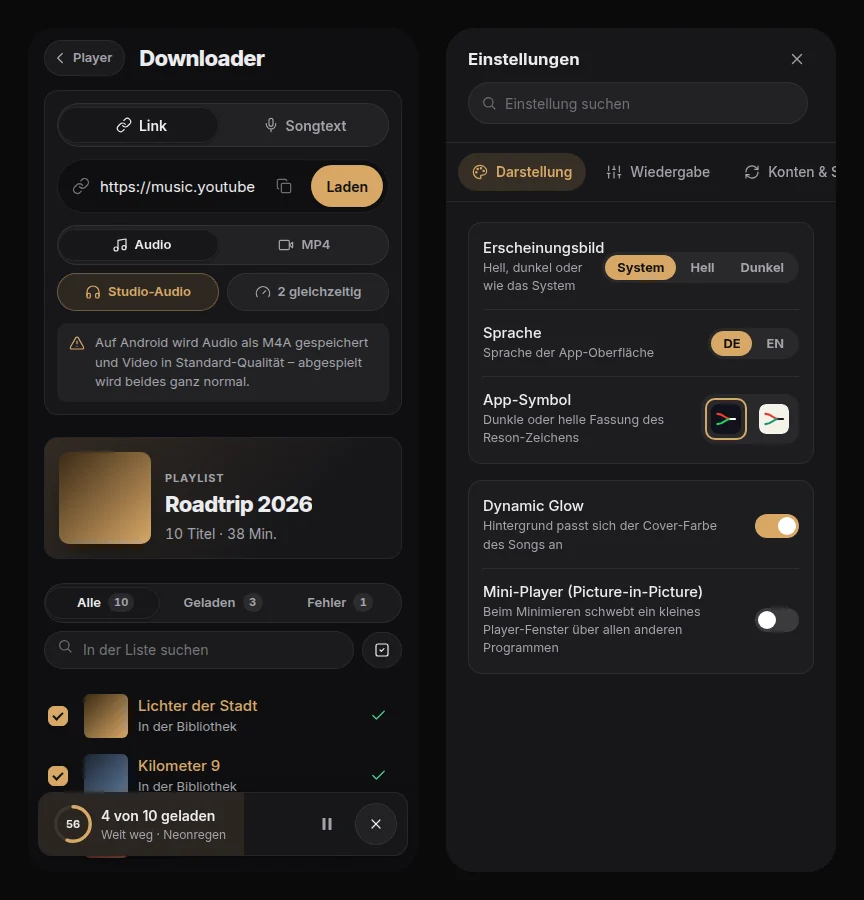
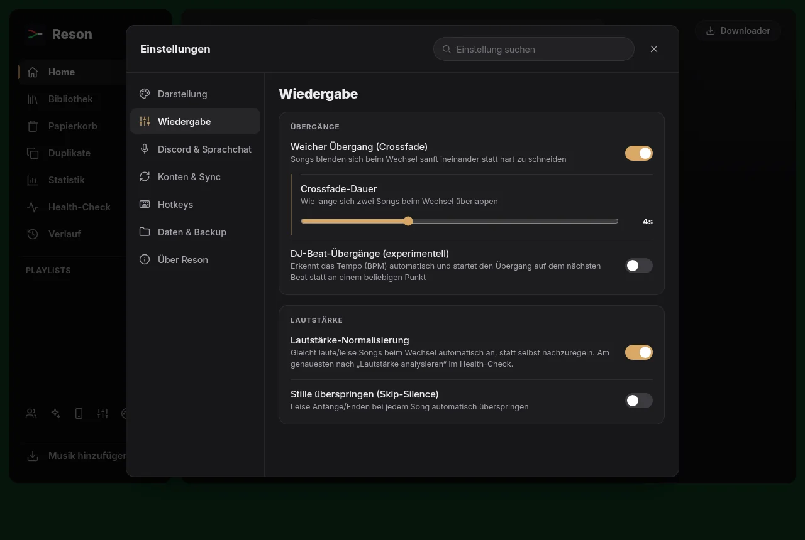

<div align="center">


# Reson

**Dein eigener Musik-Player. Ohne Abo, ohne Cloud.**

Playlists von YouTube Music, YouTube und Spotify laden, offline hören und mit Freunden
synchron mithören – auf Windows, Linux und Android.

[](https://github.com/Gaboro030/meine-musik-app/releases/latest)
[](https://github.com/Gaboro030/meine-musik-app/actions/workflows/build.yml)


**[Download](#download)** · **[Funktionen](#funktionen)** · **[Website](https://gaboro030.github.io/meine-musik-app/)** · **[Anleitungen](#anleitungen)** · **[Selbst bauen](#selbst-bauen)** · **[Wer dahintersteckt](#wer-dahintersteckt)**

<br>



</div>

<br>

Link aus YouTube Music, YouTube oder Spotify einfügen, Titel auswählen, fertig: Jeder Song
landet als MP3 mit Titel, Interpret und Cover in deiner Bibliothek. Die Dateien liegen ganz
normal auf deinem Gerät. Kein Konto, keine Werbung, kein Tracking.

## Download

| System | Datei | So geht's |
|---|---|---|
| **Windows 10 / 11** | [`windows-Reson_…_x64-setup.exe`](https://github.com/Gaboro030/meine-musik-app/releases/latest) | Doppelklick, installiert sich und startet. |
| **Linux** (x86_64) | [`ubuntu-Reson_…_amd64.AppImage`](https://github.com/Gaboro030/meine-musik-app/releases/latest) oder [`.deb`](https://github.com/Gaboro030/meine-musik-app/releases/latest) | `chmod +x Reson_*.AppImage` und starten, oder `sudo apt install ./Reson_*.deb` |
| **Android 7+** | [**`android-Reson.apk`**](https://github.com/Gaboro030/meine-musik-app/releases/latest/download/android-Reson.apk) | Auf dem Handy laden und antippen. |

Updates holt sich Reson danach selbst: Sobald eine neue Version erscheint, fragt die App
und installiert sie auf Wunsch.

> [!NOTE]
> **Windows** zeigt bei neuen Apps ohne teures Herausgeber-Zertifikat „Der Computer wurde
> geschützt“. Auf **Weitere Informationen** und dann **Trotzdem ausführen** klicken.
> **Android** fragt beim ersten Mal, ob dein Browser Apps installieren darf: einmal erlauben.

## Funktionen

**Downloader**
- Playlists, Alben und einzelne Songs von **YouTube Music, YouTube und Spotify**
- **MP3** mit 128–320 kbps oder **MP4** bis 1080p, mit Titel, Interpret und quadratisch zugeschnittenem Cover
- Mehrere Titel gleichzeitig, Fortschritt je Titel, Pause und Abbrechen
- Nicht verfügbare Titel werden übersprungen, ein Fehlerbericht erklärt, warum
- **Studio-Audio**: nimmt den reinen Audio-Upload statt des Musikvideo-Tons, wenn es ihn gibt
- Songs über eine **Zeile aus dem Songtext** finden

**Player**
- Crossfade, DJ-Übergänge im Takt, Lautstärke-Normalisierung, Stille überspringen
- Equalizer, Songtexte, Visualizer, Mini-Player
- Hintergrund, der sich der Cover-Farbe anpasst
- Papierkorb, Duplikate finden, Statistik, Verlauf, Health-Check der Bibliothek
- Frei belegbare Hotkeys, auch global im Hintergrund

**Zusammen hören**
- **Party-Modus**: Alle Geräte im WLAN spielen synchron, Gäste scannen nur einen QR-Code
- **Internet-Link**: Freunde kommen auch ohne gleiches WLAN rein (Cloudflare-Tunnel, ohne Portfreigabe, ohne Konto)
- **Wunschliste**: Gäste schicken Songs direkt vom Handy in deine Warteschlange
- **Freunde**: Freundescode austauschen und sich weltweit einladen, Ende-zu-Ende verschlüsselt
- **Sprachchat**: Musik in Discord, WhatsApp oder ins Spiel schicken, deine Stimme bleibt hörbar
- **Discord-Status**: „Hört … von …“ mit Cover und Fortschritt

**Rest**
- Reson-Design hell und dunkel, dazu 18 weitere Themes und ein Editor für eigene
- **Geräte-Sync**: Playlists vom PC aufs Handy und zurück
- **Playlists abgleichen** mit Spotify und YouTube Music
- Backup von Einstellungen und kompletter Bibliothek als ZIP
- Deutsch und Englisch

<p align="center">
  
</p>

<p align="center">
  
</p>

## Anleitungen

<details>
<summary><b>Party-Modus in drei Schritten</b></summary>

<br>

1. In der Seitenleiste auf das **Personen-Symbol** klicken.
2. Freunde scannen den **QR-Code** mit der Handykamera, ohne App.
3. Alle hören synchron mit und können sich Songs wünschen.

Mit **Internet-Link** klappt das auch über mobile Daten: Der Link läuft über einen kostenlosen
Cloudflare-Tunnel, ohne Portfreigabe.

> Beim ersten Start fragt die **Windows-Firewall**. „Zulassen“ klicken, sonst kommen Gäste nicht rein.

</details>

<details>
<summary><b>Spotify-Playlists laden</b></summary>

<br>

YouTube- und YouTube-Music-Links funktionieren ohne Einrichtung. Für Spotify-Playlists braucht
Reson einmalig kostenlose Zugangsdaten von
[developer.spotify.com/dashboard](https://developer.spotify.com/dashboard): `SPOTIFY_CLIENT_ID`
und `SPOTIFY_CLIENT_SECRET` als Umgebungsvariablen setzen. Reson sucht dann jeden Titel auf
YouTube; Titel ohne Treffer werden übersprungen.

</details>

<details>
<summary><b>Musik im Sprachchat mithören lassen (Windows)</b></summary>

<br>

Freunde sollen die Musik in Discord, WhatsApp, TeamSpeak oder einem Spiel mithören und dich
dabei weiter reden hören.

**Warum eine Installation nötig ist:** Windows lässt keine Anwendung sich als Mikrofon
anmelden; das ist Treiberarbeit. Jedes Soundboard (Voicemod, Soundpad …) installiert deshalb
einen Treiber. Ein **virtuelles Kabel** meldet sich gleichzeitig als Ausgabe- *und*
Aufnahmegerät an: Was man hineinschickt, ist für jedes andere Programm ein Mikrofon.
**Das Mischen übernimmt Reson selbst**, ein Mischprogramm wie VoiceMeeter ist nicht nötig.

```
   Musik (hinter EQ) ──> Lautstärke ─┐
                                     ├──> Kabel ──> Discord / WhatsApp / Spiel
   Dein Mikrofon ─────> Lautstärke ─┘
```

**Einrichtung (einmalig):**

1. [VB-Cable](https://vb-audio.com/Cable/) installieren (kostenlos), danach neu starten.
2. In Reson: **Einstellungen → Discord & Sprachchat → Musik an den Sprachchat weitergeben**
   einschalten. Das Kabel wird automatisch als Ziel vorgeschlagen.
3. **Lautstärken** einstellen: Musik deutlich leiser als die Stimme, 30–40 % ist ein guter Start.
4. In Discord/WhatsApp/im Spiel als Mikrofon **`CABLE Output`** wählen. Einmal pro Programm.

**Damit es „Reson Mikro“ heißt:** Windows-Einstellungen → **System** → **Sound** →
**Weitere Soundeinstellungen** → `CABLE Output` → **Umbenennen** → `Reson Mikro`.
Dasselbe geht mit `CABLE Input` (z. B. `Reson Ausgang`).

Du hörst weiter ganz normal über deine Kopfhörer; die beiden Regler gelten nur für das, was
drüben ankommt.

> **Kopfhörer benutzen.** Über Lautsprecher nimmt dein Mikrofon die Musik ein zweites Mal auf.

**Ganz ohne Installation** geht es auch, dann aber nicht über das Mikrofon:
- **Discord-Bildschirmteilen mit Ton**: im Sprachkanal „Bildschirm“, Reson wählen, **Ton** an.
- **Party-Modus**: Freunde hören synchron über Link oder QR-Code mit, in voller Qualität.

</details>

<details>
<summary><b>Ruckelt die App unter Linux?</b></summary>

<br>

Mit dem proprietären **NVIDIA-Treiber** schaltet Reson beim Start selbst zwei Grafikwege von
WebKitGTK ab, die dort sehr langsam sind (`WEBKIT_DISABLE_DMABUF_RENDERER=1`,
`__NV_DISABLE_EXPLICIT_SYNC=1`). Wer die Variablen selbst setzt, behält seine Werte.
Bleibt es zäh, hilft als letzter Ausweg:

```bash
WEBKIT_DISABLE_COMPOSITING_MODE=1 ./Reson_*.AppImage
```

</details>

## Selbst bauen

Voraussetzungen: [Rust](https://rustup.rs), Node 20+, unter Linux die WebKitGTK-Pakete
(siehe `.github/workflows/build.yml`).

```bash
npm install
npx tauri icon icons-source.png   # App-Icons erzeugen
npm run dev                       # Entwicklungsfenster
npm run build                     # fertige Installer in dist-app/
```

yt-dlp und cloudflared gehören als Sidecar nach `src-tauri/binaries/` (Namensschema und
Download siehe `.github/workflows/build.yml`; die CI macht das automatisch).

**Android:** `npm run android:init` (Android SDK + NDK nötig), dann
`node scripts/merge-android-extras.mjs` und `npm run build:android`. Ergebnis:
`dist-app/android-Reson.apk`, direkt installierbar.

**Release:** Version in `package.json`, `src-tauri/tauri.conf.json` und `src-tauri/Cargo.toml`
anheben und einen Tag `vX.Y.Z` pushen. Die CI baut alle drei Plattformen und veröffentlicht das
Release samt `latest.json` für das In-App-Update.

<details>
<summary><b>Technik und Aufbau</b></summary>

<br>

| Schicht | Technologie | Warum |
|---|---|---|
| Kern | Rust + Tauri 2 | Nativ, klein, schnell, ein Codebestand für drei Plattformen |
| Downloads (PC) | yt-dlp + ffmpeg als Sidecar | Das bewährteste Werkzeug dafür |
| Downloads (Android) | eigene Innertube-Anbindung | yt-dlp gibt es für Android nicht |
| Party-Server | axum, eingebettet | LAN- und Internet-Gäste ohne eigenen Server |
| Oberfläche | Vanilla JS + CSS | Kein Framework-Ballast, startet sofort |

```
src/                  Oberfläche (Player, Downloader, Themes, Einstellungen)
src-tauri/src/
  commands.rs         Bibliothek, Streaming, Downloads
  innertube.rs        Android-Downloads über YouTubes Innertube-API
  party.rs            Eingebetteter LAN-/Internet-Server + QR
  playlist.rs         Spotify-/YouTube-/YT-Music-Auflösung
  discovery.rs        Empfehlungen + Online-Suche
  trash.rs, lyrics.rs, sync.rs, health.rs …
android-extra/        Hintergrund-Wiedergabe auf Android
website/              Werbe- und Download-Seite (GitHub Pages)
.github/workflows/    CI: Windows + Linux + Android parallel, Release bei Tag
```

**Android-Downloads und PoToken:** Seit 2025 verlangt YouTube für Downloads meist einen
**PoToken**, eine Bestätigung, dass eine echte Google-JS-Umgebung anfragt. Da die Tauri-WebView
selbst eine echte Browser-Engine ist, erzeugt die App den Token clientseitig:
`src/bgutils.js` (unverändert von [bgutils-js](https://github.com/LuanRT/BgUtils), MIT) führt
Googles BotGuard-Skript aus, `src/potoken.js` / `potoken-init.js` starten das im Hintergrund und
übergeben das Ergebnis per `set_po_token` an Rust. `innertube.rs` hängt den Token an jeden
`/player`-Aufruf und an die Stream-URL. Dafür braucht die WebView `script-src 'unsafe-eval'` –
eine Voraussetzung von BotGuard, keine Bequemlichkeit.

</details>

<details>
<summary><b>In den Google Play Store bringen</b></summary>

<br>

Play nimmt **keine Debug-APK** an, sondern ein **signiertes AAB**. Das baut die CI automatisch,
sobald ein Schlüssel hinterlegt ist. Ohne Schlüssel entsteht weiter die APK zum
Selbst-Installieren.

**Einmalig: Upload-Schlüssel erzeugen** (`keytool` kommt mit dem JDK):

```bash
keytool -genkeypair -v -keystore upload-keystore.jks -keyalg RSA -keysize 2048 -validity 10000 -alias upload
```

> [!WARNING]
> **Diese Datei und das Passwort niemals verlieren und niemals veröffentlichen.** Ohne sie lässt
> sich die App bei Play nie wieder aktualisieren. Die Datei gehört **nicht** ins Projekt
> (`.gitignore` blockt `*.jks`).

**Dann unter GitHub → Settings → Secrets and variables → Actions** anlegen:

| Name | Inhalt |
|---|---|
| `ANDROID_KEYSTORE_BASE64` | die `.jks`-Datei als Base64: `base64 -w0 upload-keystore.jks` |
| `ANDROID_KEYSTORE_PASSWORD` | Passwort des Schlüsselspeichers |
| `ANDROID_KEY_ALIAS` | `upload` (bzw. der gewählte Alias) |
| `ANDROID_KEY_PASSWORD` | Passwort des Schlüssels |

Ab dem nächsten Push liegen in den CI-Artefakten `android-Reson.aab` (für Play) **und**
`android-Reson.apk`. Play lehnt jeden Upload ab, dessen `versionCode` nicht höher ist als der
letzte; der kommt aus `version` in `tauri.conf.json`.

</details>

## Wer dahintersteckt

<table>
  <tr>
    <td align="center" width="180">
      <a href="https://github.com/Gaboro030"><br /><b>Gaboro030</b></a>
    </td>
    <td align="center" width="180">
      <a href="https://github.com/Emre1001"><br /><b>Emre1001</b></a>
    </td>
  </tr>
</table>

Reson wurde von **[Gaboro030](https://github.com/Gaboro030)** und **[Emre1001](https://github.com/Emre1001)** gemacht.
Ablauf und Download-Logik des Downloaders stammen aus Emre1001s
[Ytms-to-mp3](https://github.com/Emre1001/Ytms-to-mp3).

**Danke an** [yt-dlp](https://github.com/yt-dlp/yt-dlp), [FFmpeg](https://ffmpeg.org),
[Tauri](https://tauri.app), [cloudflared](https://github.com/cloudflare/cloudflared),
[bgutils-js](https://github.com/LuanRT/BgUtils) und [VB-Cable](https://vb-audio.com/Cable/).

## Hinweise

- Nur Musik herunterladen, an der du die Rechte hast oder die du privat nutzen darfst.
- Bei manchen Formaten zeigt die Titeldauer noch „—“ (kein vollständiger Decoder eingebaut).
